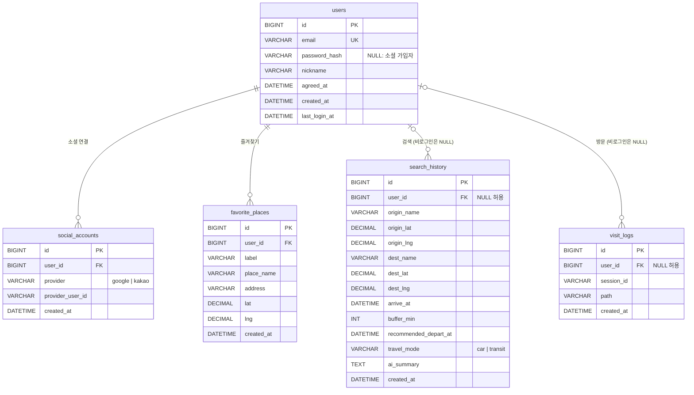

# 길잇 DB

MySQL 8.0.16 이상 (AWS RDS for MySQL 8), 문자셋 `utf8mb4`, 엔진 InnoDB.

| 파일 | 내용 |
| --- | --- |
| `schema.sql` | 테이블 5개. `CREATE TABLE IF NOT EXISTS`라 다시 실행해도 된다 |
| `seed.sql` | 개발·테스트용 더미 데이터. 운영 DB에는 실행하지 않는다 |

테이블 정의는 `schema.sql` 한 곳에만 둔다. 이미 만든 테이블의 구조를 바꿀 때는 `schema.sql`을 고치고, 운영 DB에 적용할 `ALTER TABLE` 문을 따로 작성해 실행한다 (`CREATE TABLE IF NOT EXISTS`는 이미 있는 테이블을 바꾸지 않는다).

## ERD



## 테이블

### users

회원. 이메일 가입자와 소셜 가입자가 함께 있고, 계정은 이메일 하나당 하나다.

- `email`: UNIQUE. 앞뒤 공백을 지우고 소문자로 바꿔 저장한다. 콜레이션(`utf8mb4_0900_ai_ci`)도 대소문자를 구분하지 않는다.
- `password_hash`: bcrypt(cost 12 이상) 해시. 소셜로만 가입한 사용자는 NULL이다. 평문 비밀번호는 어디에도 저장하지 않는다.
- `agreed_at`: 필수 약관(이용약관·개인정보 처리방침)에 동의한 시각
- `last_login_at`: 로그인할 때마다 갱신한다 (이메일·소셜 공통)
- 가입 방법은 컬럼으로 따로 두지 않는다. `password_hash`가 있으면 이메일 가입, 없으면 `social_accounts`의 제공자로 판단한다.

### social_accounts

소셜 로그인 연결. `(provider, provider_user_id)` UNIQUE로 같은 소셜 계정이 두 사용자에 연결되지 않게 하고, `(user_id, provider)` UNIQUE로 한 사용자에 같은 제공자 계정이 두 개 붙지 않게 한다. 사용자를 지우면 함께 지워진다 (`ON DELETE CASCADE`).

- `provider`: `google` 또는 `kakao` (CHECK 제약)
- `provider_user_id`: Google은 `sub`, 카카오는 회원번호

### favorite_places

즐겨찾기 장소. 사용자를 지우면 함께 지워진다.

- `label`: `집`, `학교`, `회사`, `기타` 중 하나 (API의 `type`). 값 검사는 서버에서 한다.
- `place_name`: 장소 이름 (API의 `name`)
- `lat`, `lng`: 필수. `DECIMAL(10,7)`은 약 1cm 정밀도다.

### search_history

길찾기 검색 기록. 비로그인 검색도 `user_id` NULL로 남겨 인기 출발지·목적지와 검색 수 통계에 쓴다. 회원이 탈퇴하면 기록은 남기고 `user_id`만 NULL이 된다 (`ON DELETE SET NULL`).

- `arrive_at`: 도착 희망 시각, `buffer_min`: 여유 시간(분, 0 이상)
- `recommended_depart_at`: 추천 경로의 권장 출발 시각
- `travel_mode`: `car` 또는 `transit` (CHECK 제약). 지금 서비스는 `car`만 쓴다.
- `ai_summary`: AI 경로 추천 요약 문구

### visit_logs

페이지 방문 로그. 방문자 수 통계에 쓴다. 회원이 탈퇴하면 `user_id`만 NULL이 된다.

- `session_id`: 서버가 발급한 방문자 쿠키 값. 같은 방문자의 중복 방문을 구분한다 (방문자 수 = `session_id` 개수).

## 제약과 인덱스

| 테이블 | 제약·인덱스 | 용도 |
| --- | --- | --- |
| users | `uq_users_email` (email) | 이메일 중복 가입 방지, 로그인 조회 |
| social_accounts | `uq_social_provider_user` (provider, provider_user_id) | 소셜 로그인 조회, 중복 연결 방지 |
| social_accounts | `uq_social_user_provider` (user_id, provider) | 사용자당 제공자 하나, FK 인덱스 |
| social_accounts | `fk_social_user` → users, CASCADE | |
| favorite_places | `idx_favorite_user` (user_id) | 내 즐겨찾기 목록 |
| favorite_places | `fk_favorite_user` → users, CASCADE | |
| search_history | `idx_history_user_created` (user_id, created_at) | 내 검색 기록 최신순 |
| search_history | `idx_history_dest` (dest_name), `idx_history_origin` (origin_name) | 인기 목적지·출발지 |
| search_history | `fk_history_user` → users, SET NULL | |
| visit_logs | `idx_visit_created` (created_at) | 일별·월별 방문자 |
| visit_logs | `idx_visit_path` (path) | 페이지별 방문 |
| visit_logs | `idx_visit_user` (user_id) | FK 검사 |
| visit_logs | `fk_visit_user` → users, SET NULL | |

## 시간대

모든 `DATETIME`은 한국 시간(KST)으로 저장한다. RDS의 기본 시간대는 UTC이므로 둘 중 하나를 한다.

- 서버가 DB에 연결할 때마다 `SET time_zone = '+09:00';`을 실행한다 (권장. 코드에 드러나서 놓치기 어렵다)
- 또는 RDS 파라미터 그룹에서 `time_zone`을 `Asia/Seoul`로 바꾼다

API는 `2026-11-02T09:00:00+09:00` 형식으로 주고받는다 (`docs/api-spec.md`).

## RDS에서 실행하기

1. RDS for MySQL 8 인스턴스를 만들고, 보안 그룹 인바운드에 3306 포트를 내 IP(또는 EC2 보안 그룹)로만 연다.
2. 접속해서 DB와 서비스용 계정을 만든다. 마스터 계정은 서버 코드에서 쓰지 않는다.

   ```sql
   CREATE DATABASE IF NOT EXISTS gilit CHARACTER SET utf8mb4 COLLATE utf8mb4_0900_ai_ci;
   CREATE USER 'gilit_app'@'%' IDENTIFIED BY '<비밀번호>';
   GRANT SELECT, INSERT, UPDATE, DELETE ON gilit.* TO 'gilit_app'@'%';
   ```

3. 스키마를 실행한다. 개발·테스트 DB라면 시드도 넣는다.

   ```bash
   mysql -h <RDS 엔드포인트> -u admin -p --default-character-set=utf8mb4 gilit < db/schema.sql
   mysql -h <RDS 엔드포인트> -u admin -p --default-character-set=utf8mb4 gilit < db/seed.sql
   ```

   PowerShell은 `<` 리디렉션이 안 되므로 `mysql ... gilit -e "source db/schema.sql"`을 쓰거나, MySQL Workbench에서 파일을 열어 실행한다.

4. 확인한다.

   ```sql
   SHOW TABLES;                       -- 5개
   SHOW CREATE TABLE search_history;  -- FK, CHECK, 인덱스 확인
   SELECT TABLE_NAME, CONSTRAINT_NAME, REFERENCED_TABLE_NAME
   FROM information_schema.REFERENTIAL_CONSTRAINTS WHERE CONSTRAINT_SCHEMA = 'gilit';
   ```

접속 정보(엔드포인트, 계정, 비밀번호)는 `.env`에만 두고 커밋하지 않는다.

## 이용 통계 쿼리 예시

`GET /api/stats` 응답을 만드는 쿼리다. 방문자는 `session_id` 기준이다. 모든 쿼리는 파라미터 바인딩으로 실행한다.

```sql
-- 최근 7일 일별 방문자 (dailyVisitors). 방문이 없는 날은 서버에서 0으로 채운다.
SELECT DATE(created_at) AS date, COUNT(DISTINCT session_id) AS count
FROM visit_logs
WHERE created_at >= CURDATE() - INTERVAL 6 DAY
GROUP BY DATE(created_at)
ORDER BY date;

-- 누적 방문자 (totalVisitors), 이번 달 방문자 (monthVisitors)
SELECT COUNT(DISTINCT session_id) FROM visit_logs;
SELECT COUNT(DISTINCT session_id) FROM visit_logs
WHERE created_at >= DATE_FORMAT(CURDATE(), '%Y-%m-01');

-- 누적 검색 수 (totalSearches)
SELECT COUNT(*) FROM search_history;

-- 인기 목적지 상위 5개 (popularDestinations). 출발지는 origin_name으로 같은 쿼리
SELECT dest_name AS name, COUNT(*) AS count
FROM search_history
WHERE dest_name IS NOT NULL
GROUP BY dest_name
ORDER BY count DESC
LIMIT 5;
```

`weekChangePct`는 최근 7일과 그 전 7일의 방문자 합계로 서버에서 계산한다.
