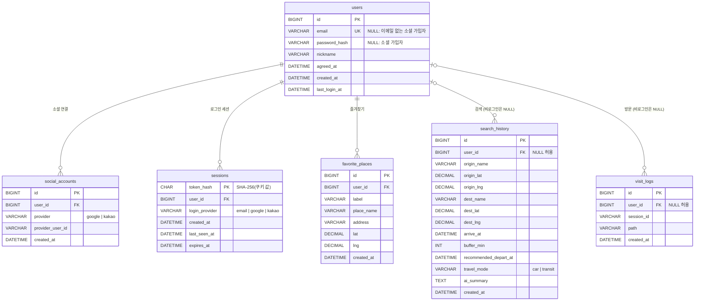

# 길잇 DB

MySQL 8.0.16 이상 (AWS RDS for MySQL 8), 문자셋 `utf8mb4`, 엔진 InnoDB.

| 파일 | 내용 |
| --- | --- |
| `schema.sql` | 테이블 6개의 **최종 구조**. `CREATE TABLE IF NOT EXISTS`라 다시 실행해도 된다 |
| `migrations/NNN_*.sql` | 이미 만든 DB에 적용할 구조 변경. 번호 순서대로 실행한다 |
| `seed.sql` | 개발·테스트용 더미 데이터. 운영 DB에는 실행하지 않는다 |

테이블 정의는 `schema.sql`이 항상 최종 상태다. 구조를 바꿀 때는 `schema.sql`을 고치고, 같은 변경을 `migrations/`에 다음 번호로 남긴다 (`CREATE TABLE IF NOT EXISTS`는 이미 있는 테이블을 바꾸지 않는다). 마이그레이션은 다시 실행해도 결과가 같게 쓴다.

| 번호 | 내용 |
| --- | --- |
| `001_users_email_nullable.sql` | `users.email` NULL 허용 (카카오 가입자는 이메일이 없을 수 있다) |
| `002_sessions.sql` | 로그인 세션 테이블 `sessions` |
| `003_favorite_places_constraints.sql` | `favorite_places`: UNIQUE(user_id, place_name), CHECK(label), `idx_favorite_user` 삭제. 적용 전 중복 확인 쿼리가 파일 맨 위에 있다 |

**이미 만든 DB에 어디까지 적용됐는지 확인하기** (관리자든 서비스 계정이든 된다):

```sql
SELECT 'sessions(002)' AS step, COUNT(*) > 0 AS applied FROM information_schema.TABLES
  WHERE TABLE_SCHEMA = DATABASE() AND TABLE_NAME = 'sessions'
UNION ALL
SELECT 'uq_favorite_user_name(003)', COUNT(*) > 0 FROM information_schema.STATISTICS
  WHERE TABLE_SCHEMA = DATABASE() AND TABLE_NAME = 'favorite_places' AND INDEX_NAME = 'uq_favorite_user_name';
```

## ERD



## 테이블

### users

회원. 이메일 가입자와 소셜 가입자가 함께 있고, 이메일이 있는 계정은 이메일 하나당 하나다.

- `email`: UNIQUE, NULL 허용. 앞뒤 공백을 지우고 소문자로 바꿔 저장한다. 콜레이션(`utf8mb4_0900_ai_ci`)도 대소문자를 구분하지 않는다. 카카오처럼 이메일을 주지 않거나 검증되지 않은 이메일을 주는 소셜 가입자는 NULL이다 (UNIQUE는 NULL을 여러 개 허용한다). 같은 이메일 가입은 INSERT의 UNIQUE 위반(1062)으로 막으므로 동시에 가입해도 하나만 성공한다.
- `password_hash`: bcrypt(cost 12 이상) 해시. 소셜로만 가입한 사용자는 NULL이다. 평문 비밀번호는 어디에도 저장하지 않는다.
- `agreed_at`: 필수 약관(이용약관·개인정보 처리방침)에 동의한 시각
- `last_login_at`: 로그인할 때마다 갱신한다 (이메일·소셜 공통)
- 가입 방법은 컬럼으로 따로 두지 않는다. `password_hash`가 있으면 이메일 가입, 없으면 `social_accounts`의 제공자로 판단한다. API 응답의 `provider`는 가입 방법이 아니라 이번 세션의 로그인 방식(`sessions.login_provider`)이다.
- 소셜 첫 로그인으로 가입할 때 `users`와 `social_accounts`를 한 트랜잭션으로 넣는다. `email`에는 제공자가 검증했다고 알려 준 이메일만 넣고(아니면 NULL), 그 이메일이 이미 있으면 계정을 만들지 않는다 (자동 연결 없음, `docs/api-spec.md` "소셜 계정 처리").

### social_accounts

소셜 로그인 연결. `(provider, provider_user_id)` UNIQUE로 같은 소셜 계정이 두 사용자에 연결되지 않게 하고, `(user_id, provider)` UNIQUE로 한 사용자에 같은 제공자 계정이 두 개 붙지 않게 한다. 사용자를 지우면 함께 지워진다 (`ON DELETE CASCADE`).

- `provider`: `google` 또는 `kakao` (CHECK 제약)
- `provider_user_id`: Google은 `sub`, 카카오는 회원번호

### sessions

로그인 세션 (서버 세션 쿠키 `gilit_session`). 서버(`backend/app/auth/mysql_stores.py`)만 읽고 쓴다. 사용자를 지우면 함께 지워진다.

- `token_hash`: 쿠키 값의 SHA-256 (16진수 64자). 쿠키 원문은 저장하지 않으므로 DB가 유출돼도 쿠키를 만들 수 없다.
- `login_provider`: 이번 세션의 로그인 방식 (`email` | `google` | `kakao`, CHECK 제약). API 사용자 객체의 `provider`다.
- `expires_at`: 로그인 시각 + 14일 고정. 사용해도 늘어나지 않는다. 만료된 행은 서버가 로그인할 때 지운다.
- `last_seen_at`: 마지막 사용 시각. 1시간에 한 번까지만 갱신한다.
- 로그인할 때마다 새 행을 만들고, 그 브라우저의 이전 세션 행은 지운다 (세션 고정 방지).
- `visit_logs.session_id`(방문자 쿠키)와는 다른 값이다.

### favorite_places

즐겨찾기 장소. 사용자를 지우면 함께 지워진다 (`ON DELETE CASCADE`).

- `label`: `집`, `학교`, `회사`, `기타` 중 하나 (API의 `type`). 서버가 검사하고 DB도 CHECK(`chk_favorite_label`)로 막는다.
- `place_name`: 사용자가 붙인 별칭 (API의 `name`). 같은 사용자 안에서 하나만 있다 (`uq_favorite_user_name`). 콜레이션 때문에 대소문자·악센트·전각을 구분하지 않는다 (`Home`=`home`, `Café`=`cafe`, `Ａ`=`A`).
- `lat`, `lng`: 필수. `DECIMAL(10,7)`은 약 1cm 정밀도다. 서버가 소수 7자리로 맞춰 넣는다.
- 사용자당 최대 20개는 서버가 지킨다. 추가할 때 그 사용자의 `users` 행을 `SELECT ... FOR UPDATE`로 잠그고 개수를 센 뒤 같은 트랜잭션에서 넣으므로, 동시에 추가해도 넘지 않는다.

### search_history

길찾기 검색 기록. 비로그인 검색도 `user_id` NULL로 남겨 인기 출발지·목적지와 검색 수 통계에 쓴다. 회원이 탈퇴하면 기록은 남기고 `user_id`만 NULL이 된다 (`ON DELETE SET NULL`).

- `arrive_at`: 도착 희망 시각, `buffer_min`: 여유 시간(분, 0 이상)
- `recommended_depart_at`: 추천 경로의 권장 출발 시각
- `travel_mode`: `car` 또는 `transit` (CHECK 제약). 지금 서비스는 `car`만 쓴다.
- `ai_summary`: AI 경로 추천 요약 문구

### visit_logs

페이지 방문 로그. 방문자 수 통계에 쓴다. 회원이 탈퇴하면 `user_id`만 NULL이 된다.

- `session_id`: 서버가 발급한 방문자 쿠키 값. 같은 방문자의 중복 방문을 구분한다 (방문자 수 = `session_id` 개수).

## 제약과 인덱스

| 테이블 | 제약·인덱스 | 용도 |
| --- | --- | --- |
| users | `uq_users_email` (email) | 이메일 중복 가입 방지, 로그인 조회 |
| social_accounts | `uq_social_provider_user` (provider, provider_user_id) | 소셜 로그인 조회, 중복 연결 방지 |
| social_accounts | `uq_social_user_provider` (user_id, provider) | 사용자당 제공자 하나, FK 인덱스 |
| social_accounts | `fk_social_user` → users, CASCADE | |
| sessions | PK (token_hash) | 쿠키로 세션 조회 |
| sessions | `idx_sessions_user` (user_id) | 사용자별 세션, FK 인덱스 |
| sessions | `idx_sessions_expires` (expires_at) | 만료 세션 정리 |
| sessions | `fk_sessions_user` → users, CASCADE | |
| favorite_places | `uq_favorite_user_name` (user_id, place_name) | 같은 별칭 금지, 내 즐겨찾기 목록, FK 인덱스 (003에서 `idx_favorite_user`를 대신함) |
| favorite_places | `chk_favorite_label` CHECK (label IN 집·학교·회사·기타) | 분류 값 제한 |
| favorite_places | `fk_favorite_user` → users, CASCADE | |
| search_history | `idx_history_user_created` (user_id, created_at) | 내 검색 기록 최신순 |
| search_history | `idx_history_dest` (dest_name), `idx_history_origin` (origin_name) | 인기 목적지·출발지 |
| search_history | `fk_history_user` → users, SET NULL | |
| visit_logs | `idx_visit_created` (created_at) | 일별·월별 방문자 |
| visit_logs | `idx_visit_path` (path) | 페이지별 방문 |
| visit_logs | `idx_visit_user` (user_id) | FK 검사 |
| visit_logs | `fk_visit_user` → users, SET NULL | |

## 시간대

모든 `DATETIME`은 한국 시간(KST)으로 저장한다. RDS의 기본 시간대는 UTC이므로 둘 중 하나를 한다.

- 서버가 DB에 연결할 때마다 `SET time_zone = '+09:00';`을 실행한다 (권장. 코드에 드러나서 놓치기 어렵다)
- 또는 RDS 파라미터 그룹에서 `time_zone`을 `Asia/Seoul`로 바꾼다

API는 `2026-11-02T09:00:00+09:00` 형식으로 주고받는다 (`docs/api-spec.md`).

백엔드(`backend/app/db.py`)는 연결할 때마다 `utf8mb4`와 `SET time_zone = '+09:00'`을 적용하고, 시각을 한국 시각(초 단위)으로 바꿔 저장한다. 그래서 로컬 MySQL과 RDS 어느 쪽이든 파라미터 그룹을 바꾸지 않아도 된다.

## 로컬 DB 준비 (각자 개발용)

각자 PC의 MySQL 8로 개발하고, 배포할 때는 `.env`의 `DB_*` 값만 RDS로 바꾼다. 서버 코드는 root가 아니라 서비스 계정 `gilit_app`(SELECT, INSERT, UPDATE, DELETE만)을 쓴다. 테이블을 만들고 바꾸는 일(이 문서의 SQL 파일 실행)은 관리자 계정(root)으로 한다.

명령은 저장소 루트(`gilit-web/`)에서 실행한다. Windows에서 `mysql`이 PATH에 없으면 `"C:\Program Files\MySQL\MySQL Server 8.0\bin\mysql.exe"`로 쓴다.

1. 관리자 계정으로 DB 두 개와 서비스 계정을 만든다. `gilit`은 개발 서버용, `gilit_test`는 `pytest -m mysql_live`용이다 (테스트가 회원 데이터를 지운다).

   ```bash
   mysql -u root -p
   ```

   ```sql
   CREATE DATABASE IF NOT EXISTS gilit      CHARACTER SET utf8mb4 COLLATE utf8mb4_0900_ai_ci;
   CREATE DATABASE IF NOT EXISTS gilit_test CHARACTER SET utf8mb4 COLLATE utf8mb4_0900_ai_ci;
   CREATE USER IF NOT EXISTS 'gilit_app'@'localhost' IDENTIFIED BY '<비밀번호>';
   GRANT SELECT, INSERT, UPDATE, DELETE ON gilit.*      TO 'gilit_app'@'localhost';
   GRANT SELECT, INSERT, UPDATE, DELETE ON gilit_test.* TO 'gilit_app'@'localhost';
   ```

2. 두 DB에 스키마를 적용한다 (관리자 계정).

   - **새 DB**: `schema.sql`만 실행한다. 이미 최종 구조라 마이그레이션은 필요 없다.

     ```bash
     mysql -u root -p --default-character-set=utf8mb4 gilit      -e "source db/schema.sql"
     mysql -u root -p --default-character-set=utf8mb4 gilit_test -e "source db/schema.sql"
     ```

   - **이미 만든 DB**: 위의 "어디까지 적용됐는지 확인하기"로 본 뒤, 빠진 마이그레이션을 **번호 순서대로** 실행한다. 모두 다시 실행해도 된다. `gilit`과 `gilit_test` 둘 다 한다.

     ```bash
     mysql -u root -p --default-character-set=utf8mb4 gilit -e "source db/migrations/001_users_email_nullable.sql"
     mysql -u root -p --default-character-set=utf8mb4 gilit -e "source db/migrations/002_sessions.sql"
     mysql -u root -p --default-character-set=utf8mb4 gilit -e "source db/migrations/003_favorite_places_constraints.sql"
     ```

     003은 같은 사용자의 이름이 겹치는 즐겨찾기가 있으면 실패한다. 먼저 파일 맨 위의 "적용 전 확인 쿼리"를 실행해 결과가 비어 있는지 본다. 003이 적용되지 않은 `gilit_test`에서는 `pytest -m mysql_live`의 즐겨찾기 테스트가 "마이그레이션 003이 적용되지 않았습니다"로 멈춘다 (회원 테스트는 그대로 돈다).

   Git Bash·macOS·Linux는 `-e "source ..."` 대신 `< db/schema.sql`도 된다. PowerShell은 `<` 리디렉션이 안 되므로 `-e "source ..."`를 쓴다.

3. `backend/.env`(또는 루트 `.env`)에 접속 정보를 넣는다. 커밋하지 않는다.

   ```dotenv
   AUTH_STORE=mysql
   DB_HOST=localhost
   DB_PORT=3306
   DB_NAME=gilit
   DB_USER=gilit_app
   DB_PASSWORD=<1번의 비밀번호>
   TEST_DB_NAME=gilit_test
   ```

4. 확인한다 (`backend/`에서).

   ```bash
   venv/Scripts/python -m pytest -m mysql_live      # gilit_test에서 회원 저장소 계약 테스트
   venv/Scripts/python scripts/seed_dev_users.py    # gilit에 로그인 테스트 계정 dev1·dev2@example.com (비밀번호 gilit1234)
   ```

   `seed.sql`의 계정(tester@example.com 등)은 더미 해시라 로그인할 수 없다. 이메일 로그인을 시험할 때는 `seed_dev_users.py`의 계정이나 회원가입 API로 만든 계정을 쓴다.

## RDS에서 실행하기

1. RDS for MySQL 8 인스턴스를 만들고, 보안 그룹 인바운드에 3306 포트를 내 IP(또는 EC2 보안 그룹)로만 연다.
2. 접속해서 DB와 서비스용 계정을 만든다. 마스터 계정은 서버 코드에서 쓰지 않는다.

   ```sql
   CREATE DATABASE IF NOT EXISTS gilit CHARACTER SET utf8mb4 COLLATE utf8mb4_0900_ai_ci;
   CREATE USER 'gilit_app'@'%' IDENTIFIED BY '<비밀번호>';
   GRANT SELECT, INSERT, UPDATE, DELETE ON gilit.* TO 'gilit_app'@'%';
   ```

3. 스키마를 실행한다. 개발·테스트 DB라면 시드도 넣는다.

   ```bash
   mysql -h <RDS 엔드포인트> -u admin -p --default-character-set=utf8mb4 gilit < db/schema.sql
   mysql -h <RDS 엔드포인트> -u admin -p --default-character-set=utf8mb4 gilit < db/seed.sql
   ```

   PowerShell은 `<` 리디렉션이 안 되므로 `mysql ... gilit -e "source db/schema.sql"`을 쓰거나, MySQL Workbench에서 파일을 열어 실행한다.
   이미 만든 RDS라면 `schema.sql` 대신 빠진 `migrations/`를 번호 순서대로 실행한다 (003은 적용 전 확인 쿼리를 먼저).

4. 서버의 `.env`를 RDS 값으로 바꾼다. 코드는 바꾸지 않는다.

   ```dotenv
   AUTH_STORE=mysql
   DB_HOST=<RDS 엔드포인트>
   DB_NAME=gilit
   DB_USER=gilit_app
   DB_PASSWORD=<비밀번호>
   DB_SSL_CA=<RDS CA 번들 경로>   # TLS 연결 (AWS의 global-bundle.pem)
   COOKIE_SECURE=true
   OAUTH_REDIRECT_BASE=https://<서비스 도메인>   # 소셜 로그인 콜백. Google·카카오 콘솔에도 같은 주소를 등록한다
   ```

5. 확인한다.

   ```sql
   SHOW TABLES;                       -- 6개
   SHOW CREATE TABLE search_history;  -- FK, CHECK, 인덱스 확인
   SELECT TABLE_NAME, CONSTRAINT_NAME, REFERENCED_TABLE_NAME
   FROM information_schema.REFERENTIAL_CONSTRAINTS WHERE CONSTRAINT_SCHEMA = 'gilit';
   ```

접속 정보(엔드포인트, 계정, 비밀번호)는 `.env`에만 두고 커밋하지 않는다.

## 이용 통계 쿼리 예시

`GET /api/stats` 응답을 만드는 쿼리다. 방문자는 `session_id` 기준이다. 모든 쿼리는 파라미터 바인딩으로 실행한다.

```sql
-- 최근 7일 일별 방문자 (dailyVisitors). 방문이 없는 날은 서버에서 0으로 채운다.
SELECT DATE(created_at) AS date, COUNT(DISTINCT session_id) AS count
FROM visit_logs
WHERE created_at >= CURDATE() - INTERVAL 6 DAY
GROUP BY DATE(created_at)
ORDER BY date;

-- 누적 방문자 (totalVisitors), 이번 달 방문자 (monthVisitors)
SELECT COUNT(DISTINCT session_id) FROM visit_logs;
SELECT COUNT(DISTINCT session_id) FROM visit_logs
WHERE created_at >= DATE_FORMAT(CURDATE(), '%Y-%m-01');

-- 누적 검색 수 (totalSearches)
SELECT COUNT(*) FROM search_history;

-- 인기 목적지 상위 5개 (popularDestinations). 출발지는 origin_name으로 같은 쿼리
SELECT dest_name AS name, COUNT(*) AS count
FROM search_history
WHERE dest_name IS NOT NULL
GROUP BY dest_name
ORDER BY count DESC
LIMIT 5;
```

`weekChangePct`는 최근 7일과 그 전 7일의 방문자 합계로 서버에서 계산한다.
